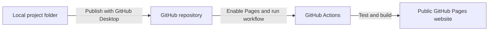

<!-- Author: Jiajun (Carson) Chen
email: jic4015@med.cornell.edu -->

# Weill Cornell Medicine Telehealth Insights

## Research and technical report

**Team**: CHERY Lab - Team formed in Weill Cornell Medicine HINF 5001 Introduction to Health Informatic Course
**Team member**: Jiajun Carson Chen, Yao Yao, Yimeng Du, Hao Chen, Ruining Wang
**Course Director**:Yunyu Xiao, PhD, Assistant Professor, Department of Population Health Sciences and Department of Psychiatry.

### Abstract

Weill Cornell Medicine Telehealth Insights (WCM-TI) is a public-data dashboard for researchers examining how telehealth use varies across U.S. states, adult population groups, and office-based visits. It brings together Medicare Telehealth Trends from CMS, household context from the American Community Survey, adult estimates from the National Health Interview Survey, and visit/payment estimates from the Medical Expenditure Panel Survey. The verified release presents CMS annual and quarterly trends for 2020–2025 and a shared 2024 focus for the other analyses.

The product combines descriptive graphics, explicit denominators, confidence intervals where estimated, downloadable aggregates, and two stored association models. An optional browser action checks the official CMS release and can update descriptive CMS views for the current session. Those values are marked not revalidated; matched-year context and models retain their verified inputs. This report documents the methods, quality controls, field definitions, validation evidence, design decisions, and procedures needed to reproduce and publish the project.

The populations and units differ across sources. The dashboard does not estimate a pooled national telehealth rate, causal effects, or individual predictions. Its contribution is a transparent research interface in which source definitions and uncertainty remain visible alongside the findings.

### Report contents

1. [Purpose, scope, and analytical modules](#scope)
2. [Methods, source provenance, and data quality](#methods-and-quality)
3. [Results and validation evidence](#validation)
4. [Data manual and complete field dictionary](#data-manual)
5. [Architecture, reproducibility, and code maintenance](#engineering)
6. [GitHub Pages deployment and troubleshooting](#deployment)
7. [Visual identity and interface design](#visual-identity)
8. [Design review and attribution](#design-review)
9. [Interpretation and future maintenance](#interpretation)
10. [Primary sources](#references)

This report is the single maintained source for research methods, data quality, field definitions, validation, design, and deployment guidance. The website continues to present its data quality note and data manual together on one separate documentation page. The README is the repository report, not an additional research module or sidebar destination.

<a id="scope"></a>

## 1. Purpose, scope, and analytical modules

The intended audience is external researchers who need to compare telehealth patterns while understanding the population, period, analytical unit, and uncertainty behind each result. The interface avoids internal assignment identifiers and presents the questions through the data themselves.

| Module                  | Data and population                                               | Available analysis                                                                                                                                                                                                                         |
| ----------------------- | ----------------------------------------------------------------- | ------------------------------------------------------------------------------------------------------------------------------------------------------------------------------------------------------------------------------------------ |
| States and connectivity | CMS Medicare Part B fee-for-service beneficiaries; ACS households | Verified state comparisons, quarterly trends, and annual percentage-point changes for 2020–2025, with optional live CMS series; matched 2024 broadband and income comparisons and the adjusted model remain fixed to the verified snapshot |
| Population differences  | NHIS 2024 U.S. civilian noninstitutionalized adults               | Survey-weighted telehealth use by insurance, age, education, Internet access, and health; a separate adjusted logistic association model with selectable covariate forest plots                                                            |
| Visits and payments     | MEPS 2024 office-based visits, all ages                           | Survey-weighted visit modality and mean total/family payments by insurance; a side-by-side comparison of telehealth visit shares with 95% confidence intervals                                                                             |
| Data and methods        | All sources                                                       | Source versions, denominators, missingness, uncertainty, and interpretation limits                                                                                                                                                         |

The three modules have different populations and units of analysis. Their rates should not be pooled or interpreted as directly interchangeable measures. The adjusted models report associations and do not establish causal effects; state-level associations do not identify relationships between individual people.

Read the [data quality note](./documentation.html#data-quality) for source coverage, exclusions, uncertainty, and interpretation limits. The [data manual](./documentation.html#data-manual) explains measures, variables, units, and downloadable data.

### Research workflow

1. Choose the module that matches the population or unit you want to study. The state, adult, and visit measures answer different questions.
2. Select a reporting period or population comparison. Read the accompanying denominator and uncertainty notes before comparing estimates.
3. Use the table view or data downloads to inspect values. The state map is schematic; its colors rescale within the selected period.
4. Compare two annual CMS periods using the annual-change view. Changes are later-year minus earlier-year rates in percentage points; the full download includes all 51 jurisdictions even when the chart shows only the ten largest absolute changes.
5. Read adjusted association results separately from descriptive comparisons. The NHIS forest plot uses a logarithmic odds-ratio axis and a reference line at 1. Adjustment does not establish a causal effect.
6. Check sample support in MEPS comparisons. Telehealth shares with fewer than 30 sampled people contributing remote visits are withheld, as are sparse modality estimates; counts remain available.

CMS is the Centers for Medicare & Medicaid Services; ACS is the American Community Survey; NHIS is the National Health Interview Survey; MEPS is the Medical Expenditure Panel Survey.

### Update behavior

“Live” means fetched on demand from the currently published CMS release, not real-time clinical activity.

**Check latest CMS data** checks the official CMS catalog and data API. Accepted records update only the CMS map, table, summary counts, quarterly trend, annual-change comparisons, and CMS CSV download. Basic structural and numeric checks do not reproduce the full analytical validation; the resulting view is marked **not revalidated** and includes retrieval and source-version information. A repeated check compares the response with the CMS data currently displayed. A failed or timed-out check leaves the current data in place and reports that the source could not be checked.

Live CMS data remain in browser memory for the session. **Restore verified snapshot**, or a page refresh, returns to the shipped CMS data. The 2024 ACS scatterplot, Pearson correlations, and adjusted state model always use the verified CMS–ACS snapshot, including when live CMS values contain a revision to 2024. NHIS, MEPS, all model outputs, and downloadable aggregate JSON files remain unchanged.

This control does not check whether every source is current. [NHIS 2025 data and documentation](https://www.cdc.gov/nchs/nhis/documentation/2025-nhis.html) are available; the dashboard’s verified NHIS analysis remains 2024. ACS, NHIS, and MEPS updates require separate source review and analytical processing. See the [data quality note](./documentation.html#data-quality) and [data manual](./documentation.html#data-manual) for scope and export metadata.

<a id="methods-and-quality"></a>

## 2. Methods, source provenance, and data quality

**Verified snapshot sources retrieved November 11, 2026 · CHERY Lab**

This dashboard describes telehealth use using three separate analytical modules. It publishes aggregates computed from official public files, with source-specific populations and denominators. It does not pool CMS, NHIS, and MEPS into one national telehealth rate.

The dashboard contains descriptive estimates, a CMS–ACS state regression, and a survey-weighted NHIS association model. Adjusted associations are distinguished from unadjusted comparisons. Neither statistical adjustment nor correlation establishes a causal effect.

CMS refers to the Centers for Medicare & Medicaid Services; ACS to the American Community Survey; NHIS to the National Health Interview Survey; and MEPS to the Medical Expenditure Panel Survey.

### Verified snapshot: scope and analytical units

| Module                         | Period                          | Population and unit                                                                                             | Main denominator                                                                                             |
| ------------------------------ | ------------------------------- | --------------------------------------------------------------------------------------------------------------- | ------------------------------------------------------------------------------------------------------------ |
| CMS Medicare Telehealth Trends | Annual and quarterly, 2020–2025 | Medicare Part B fee-for-service service users; published geographic aggregates                                  | Unique users of telehealth-eligible services during the reporting period                                     |
| ACS state context              | 2024 1-year estimates           | All households in 50 states and DC                                                                              | All households for broadband subscription; household income distribution for median income                   |
| NHIS Sample Adult              | 2024 interviews                 | Civilian noninstitutionalized adults aged 18 or older; sampled adult                                            | Adults with a valid telehealth response and a valid value for the selected grouping variable                 |
| MEPS office-based visits       | Calendar year 2024              | Office-based medical provider visits at all ages in the civilian noninstitutionalized population; sampled visit | Positive-weight office visits for shares; visits in the selected insurance/modality domain for mean payments |

Only CMS–ACS supplies state comparisons. NHIS and MEPS provide national subgroup estimates. No person-level records are linked across these sources; MEPS events are linked only to their own MEPS person file. The published site provides aggregate data; it does not distribute individual-level source records.

### Live source updates

“Live” means fetched on demand from the currently published CMS release, not real-time clinical activity.

The default view uses the verified snapshot described in this note. Selecting **Check latest CMS data** requests available Medicare Telehealth Trends records from the [official CMS catalog and data API](https://data.cms.gov/data.json). After basic structural and numeric checks, the response can update the CMS map, table, summary counts, quarterly trend, annual-change comparisons, and CMS CSV download for the current browser session. These records are explicitly labelled **not revalidated**: accepting an API response does not repeat the full source review, numerical validation, or model assessment documented below.

| Data or analysis                                                                        | Effect of the CMS source check                                                                                           |
| --------------------------------------------------------------------------------------- | ------------------------------------------------------------------------------------------------------------------------ |
| CMS map, table, summary counts, quarterly trend, annual-change comparisons, and CMS CSV | May use the accepted API response; the retrieval time, source version, and validation status identify the displayed data |
| ACS household broadband and income                                                      | Remain at the verified 2024 values                                                                                       |
| CMS–ACS scatterplot, Pearson correlations, and adjusted state model                     | Remain based on the verified 2024 CMS–ACS data, even if the live CMS response revises 2024                               |
| NHIS descriptive comparisons and adjusted model                                         | Remain at the verified 2024 analysis                                                                                     |
| MEPS visit shares and payments                                                          | Remain at the verified 2024 analysis                                                                                     |
| Aggregate JSON downloads                                                                | Continue to provide the verified snapshot files                                                                          |

Live data are held in browser memory and are not saved into the published dataset. **Restore verified snapshot**, or refreshing the page, returns the descriptive CMS view to the shipped data. A repeated check compares the new response with the CMS data currently displayed. If the request fails or times out, the current data and their status remain in place; inability to check the source is not evidence that no updates exist.

The pinned CMS source file already contains 2026 Q1, while the verified dashboard retained 2020–2025. Making an additional period visible through the API therefore does not, by itself, mean CMS published a new release. Source revisions may also change values for previously available periods.

The CMS action does not establish that ACS, NHIS, or MEPS are the newest available releases. [NHIS 2025 data and documentation](https://www.cdc.gov/nchs/nhis/documentation/2025-nhis.html) are available, but this dashboard retains the verified 2024 analysis. [ACS data queries require an API key](https://www.census.gov/data/developers/data-sets/acs-1year.2023.html); ACS updates and the survey-file processing needed for NHIS and MEPS are separate analytical tasks. Review the official source documentation when selecting a release for a new analysis.

For reproducing a CMS view loaded from the API, retain its CSV export and provenance columns. The fixed aggregate JSON and model downloads do not represent that live session. The [data manual](./documentation.html#data-manual) defines the export fields.

### Source versions and provenance

The verified snapshot files below were retrieved on **2026-11-11**. The aggregate data files preserve the full source URLs and checksums. Optional live CMS records instead carry the retrieval time and source version recorded for that session.

| Source        | Exact release or version used                                                  | Official source                                                                                                                                                                                                                                                                                                                                |
| ------------- | ------------------------------------------------------------------------------ | ---------------------------------------------------------------------------------------------------------------------------------------------------------------------------------------------------------------------------------------------------------------------------------------------------------------------------------------------- |
| CMS           | `TMEDTREND_PUBLIC_260914.csv`; catalog release date 2026-09-17                 | [CSV download](https://data.cms.gov/sites/default/files/2026-09/TMEDTREND_PUBLIC_260914.csv), [dataset](https://data.cms.gov/summary-statistics-on-use-and-payments/medicare-medicaid-service-type-reports/medicare-telehealth-trends), [dictionary](https://data.cms.gov/data-api/v1/dataset/21e3fb54-7f6c-4de9-9731-027213c2cdb3/dictionary) |
| ACS broadband | `acsdt1y2024-b28002.dat`; 2024 1-year release, 2025-09-11                      | [Table download](https://www2.census.gov/programs-surveys/acs/summary_file/2024/table-based-SF/data/1YRData/acsdt1y2024-b28002.dat), [definitions](https://api.census.gov/data/2024/acs/acs1/groups/B28002.html)                                                                                                                               |
| ACS income    | `acsdt1y2024-b19013.dat`; 2024 1-year release, 2025-09-11                      | [Table download](https://www2.census.gov/programs-surveys/acs/summary_file/2024/table-based-SF/data/1YRData/acsdt1y2024-b19013.dat), [definitions](https://api.census.gov/data/2024/acs/acs1/groups/B19013.html)                                                                                                                               |
| NHIS          | `adult24csv.zip` / `adult24.csv`; 2024 Sample Adult; codebook dated 2025-06-18 | [Archive](https://ftp.cdc.gov/pub/health_Statistics/nchs/Datasets/NHIS/2024/adult24csv.zip), [documentation](https://www.cdc.gov/nchs/nhis/documentation/2024-nhis.html), [codebook](https://ftp.cdc.gov/pub/Health_Statistics/NCHS/Dataset_Documentation/NHIS/2024/Adult-codebook.pdf)                                                        |
| MEPS visits   | HC-254G, `h254gdat.zip`; documentation dated June 2026                         | [Archive](https://meps.ahrq.gov/mepsweb/data_files/pufs/h254g/h254gdat.zip), [documentation](https://meps.ahrq.gov/data_stats/download_data/pufs/h254g/h254gdoc.shtml)                                                                                                                                                                         |
| MEPS persons  | HC-256, `h256dat.zip`; documentation dated August 2026                         | [Archive](https://meps.ahrq.gov/mepsweb/data_files/pufs/h256/h256dat.zip), [documentation](https://meps.ahrq.gov/data_stats/download_data/pufs/h256/h256doc.shtml)                                                                                                                                                                             |

MEPS fixed-width columns are read from the official [HC-254G Stata specification](https://meps.ahrq.gov/mepsweb/data_stats/download_data/pufs/h254g/h254gstu.txt) and [HC-256 Stata specification](https://meps.ahrq.gov/mepsweb/data_stats/download_data/pufs/h256/h256stu.txt). ACS estimates are read from the official table-based downloads.

#### SHA-256 fingerprints

| File                             | SHA-256                                                            |
| -------------------------------- | ------------------------------------------------------------------ |
| CMS CSV                          | `09e80f29d3b5825a88c1d04a2a71681142dadb5f06eb90805e9397afee3f37c0` |
| ACS B28002                       | `ac6ff542ba9778fce91895dd6c611e0cb22be32696b124e063d93f5e4d73e8e2` |
| ACS B19013                       | `f78748dc0221551890494e08d8239d7aecbfff9777e96a18d24f5df6a570cd86` |
| NHIS ZIP                         | `5f926b2ec0af508fa84ebc791c83bfefa6f020724754aab599004706981abdaf` |
| NHIS extracted CSV               | `31c5be8d630c13f6d0a232831a79654de7038d97fc4f33d803d8d2c84705c9d5` |
| MEPS HC-254G ZIP                 | `0b5c802880e9bb5ebe952017c98c5653ea2c8e4d1fd392b42f3e3312025a0de1` |
| MEPS HC-256 ZIP                  | `d0779e49de4f5ff0b0fff6774167023382366a0ef0905e6a3c40126114f988c9` |
| MEPS HC-254G Stata specification | `bffcd6f820de0b43219967743615023f0022542df0c5151d4554c573dfccaccd` |
| MEPS HC-256 Stata specification  | `f1545cbef3a8ebb872d0996ec8fef17cebbb6d7bc5b1310f469730835ad65ee9` |

Checksums identify the exact bytes used; they do not establish statistical accuracy. CMS–ACS checks pinned hashes before processing. NHIS and MEPS record hashes in the output; their current scripts do not reject a changed source solely because its hash differs from this table. Review changed hashes and rerun all numerical checks before replacing a published snapshot.

### CMS and ACS processing

CMS contains **37,324 source rows**. Every subgroup dimension must equal `All`; after restricting geography and period, **1,560 rows** remain: 306 state-year records, 1,224 state-quarter records, and 30 published national records. The other 35,764 rows are outside this descriptive selection, including subgroup rows, other geographies, and 2026 Q1. There are no duplicate retained geography–year–quarter keys and no missing retained rates or counts.

The map excludes national totals, Puerto Rico, the Virgin Islands, other territories, and unknown geography. The national reference series is CMS's published national aggregate; it is not reconstructed from mapped states and may include additional geographic categories. Beneficiary location follows mailing address.

`Pct_Telehealth` is a fraction in this CSV and is multiplied by 100. The denominator is `Total_Bene_TH_Elig`, not enrollment. Annual estimates use the source's `quarter=Overall` rows, preserving unique annual users. Quarterly users can recur across quarters; neither quarterly counts nor quarterly percentages are summed to obtain annual use. CMS source revisions, changing coverage and service eligibility, and coding or reimbursement changes can affect trends.

The ACS broadband file contains 8,105 geography rows and the income file 8,155. State identifiers select **50 states and D.C. (51 jurisdictions)**, excluding Puerto Rico and all other geographic levels. All 51 match 2024 CMS annual records; broadband, income, and the associated margins of error are present for every match. No household microdata are linked to Medicare beneficiaries.

Broadband is the household share with any broadband subscription, including cellular-only service. It does not measure connection speed, reliability, or digital literacy. Income is median household income in **2024 inflation-adjusted dollars**. ACS context is paired only with 2024 CMS annual use, even when other CMS years are available.

The annual-change chart compares two selected annual periods only. Each difference is the comparison-year rate minus the baseline-year rate, in **percentage points**, not relative percent change. The chart can show the ten largest absolute changes or all 51 jurisdictions; its CSV always includes all 51. Published annual rates are used directly, and no confidence intervals or significance claims are attached to these administrative differences. Optional live CMS data also feed this descriptive comparison and retain the not-revalidated label.

The state correlations are unweighted Pearson correlations across 51 observations. They have no confounder or measurement-error adjustment and no inferential interval in this release. State associations cannot identify whether individuals with broadband or higher income were more likely to use telehealth.

The separate adjusted state model uses ordinary least squares for `2024 annual telehealth percentage ~ broadband percentage + median income / 10,000`. All **50 states and D.C. (51 jurisdictions)** have complete data, receive equal weight, and enter the model. There are three parameters including the intercept and 48 residual degrees of freedom. Coefficients describe differences in telehealth **percentage points** per one broadband percentage point or **$10,000** of income, holding the other covariate fixed.

The model uses HC3 heteroskedasticity-robust standard errors and approximate **95% normal intervals**, not t intervals. Broadband has a coefficient of **0.749** (95% CI **−1.018 to 2.515**); income has a coefficient of **3.491** (95% CI **1.315 to 5.666**) per $10,000. The observed-sample R-squared is 0.518; it is not a predictive performance score. HC3 does not address spatial dependence, ACS measurement error, or omitted confounders. Alternative functional forms, influential-state sensitivity, and spatial residuals have not been evaluated. The intercept corresponds to zero broadband and zero income, outside the observed range, and has no substantive interpretation here.

ACS uncertainty uses **90%**, not 95%, margins of error. Income MOEs are published values. Broadband MOEs are approximate derived-proportion MOEs using the numerator and denominator MOEs, with the ratio fallback when the subtraction would be negative. These values accompany the state context details. The calculation follows the [Census statistical testing instructions](https://www2.census.gov/programs-surveys/acs/tech_docs/statistical_testing/2024_Instructions_for_Stat_Testing_ACS.pdf). CMS supplies administrative aggregates without survey sampling intervals; absence of an interval does not imply absence of error.

### NHIS sample and missingness

The downloaded file contains **32,629 adults**. All have usable positive final weights and survey design identifiers. `VIRAPP12M_A` has 32,324 valid yes/no responses, including **8,293 yes** responses; 305 responses are missing or unknown (**0.935%**). No additional imputation is performed in this analysis.

Each descriptive comparison uses available cases for its own grouping variable. It does not restrict every view to adults complete on all covariates. The adjusted model uses the separate complete-case sample described below.

| Field or derived grouping | Missing in source adults | Missing among 32,324 valid outcomes | Combined group analytical N |
| ------------------------- | -----------------------: | ----------------------------------: | --------------------------: |
| Telehealth outcome        |                      305 |                                   — |                      32,324 |
| Insurance hierarchy       |                      118 |                                 104 |                      32,220 |
| Age                       |                       52 |                                  47 |                      32,277 |
| Education                 |                      147 |                                 141 |                      32,183 |
| Internet access           |                      285 |                                  12 |                      32,312 |
| Self-rated health         |                       16 |                                  16 |                      32,308 |

These missingness counts overlap and must not be added as though they were different people. The supplemental insured/uninsured recode has a different available-case denominator of 32,245.

Insurance is measured at interview; telehealth refers to the preceding 12 months. The three-category insurance hierarchy distinguishes any private coverage, public/other coverage without private, and uninsured. Private coverage can coexist with other plans. These groups are not mutually exclusive underlying payer types, and they do not match MEPS annual insurance categories exactly. Age is top-coded at 85. Internet access is not equivalent to ACS household broadband subscription.

The full survey design is built before domain selection using the final adult weight (`WTFA_A`), stratum (`PSTRAT`), and nested primary sampling unit (`PPSU`): **52 strata and 662 primary sampling units (PSUs)**. R `survey` estimates weighted proportions and Taylor-linearized standard errors. The **95% logit-transformed intervals** use domain design degrees of freedom; the overall design has 610 degrees of freedom. The analysis used R 4.6.2, `survey` 4.5, and `jsonlite` 2.0.0. See the [NHIS survey description](https://ftp.cdc.gov/pub/Health_Statistics/NCHS/Dataset_Documentation/NHIS/2024/srvydesc-508.pdf).

The dashboard’s screening rule suppresses domains with fewer than 30 valid sampled adults and flags those domains or relative standard error above 30%. No current NHIS group triggers the rule. This limited screen is **not a complete implementation of NCHS presentation standards** and does not establish that all possible comparisons are reliable.

#### NHIS adjusted association model

The survey-weighted quasibinomial logistic model includes the insurance hierarchy, age in years, education, Internet access, and self-rated health simultaneously. It uses **32,027 complete-case adults**, including **8,233 telehealth users**; 602 adults are excluded. No missing values are imputed in this analysis. The full survey design is constructed before selecting the complete-case domain.

| Sequential exclusion step   | Newly excluded | Remaining adults |
| --------------------------- | -------------: | ---------------: |
| Missing telehealth outcome  |            305 |           32,324 |
| Missing insurance hierarchy |            104 |           32,220 |
| Missing age                 |             42 |           32,178 |
| Missing education           |            130 |           32,048 |
| Missing Internet access     |              7 |           32,041 |
| Missing self-rated health   |             14 |           32,027 |

These sequential counts depend on the displayed order and do not double-count adults; they therefore differ from the marginal missingness table above. Complete-case selection may introduce bias if missingness is related to use or covariates.

Reference categories are any private coverage, bachelor's degree or higher, Internet access, and excellent self-rated health. Age is modeled linearly per additional year and remains top-coded at 85. Reported effects are **adjusted odds ratios**, not risk ratios or probability differences. The model has rank 12, survey design degrees of freedom 610, and residual degrees of freedom **599**. Its **95% Wald t intervals** use Taylor-linearized covariance and those residual degrees of freedom.

The adjusted-association forest plot selects one covariate group at a time from the same 11 fitted non-intercept terms. It displays the 95% intervals on a logarithmic odds-ratio axis with a reference line at **1**. Reference categories are stated beside the selected comparison; changing the displayed covariate does not refit the model.

Relative to any private coverage, the adjusted odds ratio is **1.100** (95% CI **1.016–1.191**) for public/other coverage without private and **0.460** (95% CI **0.391–0.542**) for uninsured adults. These are conditional cross-sectional associations. The interview-time insurance/past-year telehealth mismatch remains, and adjustment does not resolve unmeasured confounding. Age nonlinearity, interactions, alternative insurance definitions, and missing-data sensitivity have not been assessed. The model estimates associations in the observed sample and is not validated for predicting individual outcomes.

### MEPS sample, unknown modality, and payments

HC-254G contains **145,818 visits**; HC-256 contains **19,140 persons**. Person identifiers are unique in HC-256, event identifiers are unique in HC-254G, and every event matches a person. Linked weights, strata, and PSU identifiers agree. Excluding **1,612 zero-weight visits** leaves **144,206 visits from 14,198 sampled persons**. All analytical visits have known annual insurance and nonnegative released payment values.

| Analytical group                 | Visits | Distinct sampled persons |
| -------------------------------- | -----: | -----------------------: |
| Any private coverage during 2024 | 87,942 |                    8,711 |
| Public only during 2024          | 54,812 |                    5,125 |
| Uninsured all year               |  1,452 |                      362 |

The source has **13,619 remote visits**, of which 13,494 have positive weights. `VISITTYPE=-1` occurs in **132,199 nonremote source visits** and is structural inapplicability, not ordinary missingness. There are **70 unknown remote-modality visits** (`-8`), all retained in the positive-weight sample. They remain an explicit category and remain in the office-visit denominator.

| Modality after weight selection |  Visits | Distinct sampled persons |
| ------------------------------- | ------: | -----------------------: |
| In person / not remote          | 130,712 |                   14,066 |
| Phone                           |   3,273 |                      693 |
| Video                           |  10,049 |                    1,170 |
| Other remote                    |     102 |                       48 |
| Unknown remote                  |      70 |                       22 |

Persons can appear in several modality rows, so person counts in this table must not be summed. Shares describe visits, not the proportion of people using telehealth. Payments are weighted mean amounts paid per visit in the displayed domain; they retain zero-payment visits. Total payments and family/out-of-pocket payments are separate measures, in 2024 US dollars. They are not billed charges, standardized prices, or savings attributable to telehealth.

There are no missing released payment values, but many are imputed. Source `IMPFLAG` counts are: not eligible for imputation 311; complete household data 25,251; complete provider data 32,220; fully imputed 57,478; partially imputed 28,425; capitation imputation 2,133. The analysis retains released values and does not claim they were all directly observed.

MEPS estimates use `PERWT24F`, `VARSTR`, and `VARPSU`, retaining the full positive-weight person-file PSU universe for domain variance estimation: **105 strata, 264 PSUs, 159 design degrees of freedom**. A with-replacement Taylor ratio estimator produces standard errors. Intervals use **95% normal approximation**, `estimate ± 1.959964 × SE`; percentages are clipped to 0–100 and payment lower limits to zero. These intervals are approximate, particularly for rare modalities and skewed payments; they do not separately estimate additional uncertainty from imputation.

The dashboard flags domains with fewer than 30 sampled persons, relative standard error above 30%, or boundary proportions. For modality shares, the small-sample screen also checks persons contributing to the modality numerator. For example, uninsured phone and video visits arise from only 11 and 18 sampled persons, respectively. This screen is not an official AHRQ publication rule.

The dashboard applies an additional display rule: modality estimates based on **fewer than 30 sampled persons, including zero**, are withheld from charts, tables, and CSV exports as “Not shown” or unavailable. Overall telehealth shares within each insurance group use the same threshold applied to **distinct sampled persons contributing remote visits**, rather than the larger denominator count of all people with office visits. Categories and sampled visit/person counts remain visible.

| Insurance domain     | Sampled people contributing telehealth visits | Telehealth share display |
| -------------------- | --------------------------------------------: | ------------------------ |
| All insurance groups |                                         1,721 | Displayed                |
| Any private          |                                         1,202 | Displayed                |
| Public only          |                                           493 | Displayed                |
| Uninsured all year   |                                            26 | Withheld                 |

The insurance comparison chart places the three insurance-specific telehealth visit shares and their 95% intervals side by side; its denominator is all positive-weight office visits in the respective insurance group. The uninsured estimate is withheld in this comparison, its CSV, and the selected-group headline. These are visit shares, not the percentage of people using telehealth. Insurance reflects annual coverage rather than the payer at a particular visit.

Estimates passing the count threshold but with relative standard error above 30% remain displayed with an **Unstable** flag. Aggregate JSON retains computed estimates and flags for reproducibility and is therefore distinct from a display-ready export; downstream users must apply the same display rule. Empty payment domains are `null`, not zero. An observed zero share remains a flagged boundary result in JSON, even when withheld from the interface.

### Checks completed and remaining limits

The independent numerical audit on November 11, 2026 checked the verified snapshot against the raw source files. It does not revalidate records loaded by the optional CMS source check:

- **CMS:** all **1,560 retained national/state-period records** match the source data. Rates recalculated from unique-user counts differ from published rates by at most **0.00499522 percentage points**, within the **0.005001** source-rounding tolerance. Geography, keys, source scale, and fingerprints were checked.
- **ACS:** all **51 state/DC records** match the source tables, including broadband numerator/denominator, income, and margins of error.
- **CMS–ACS model:** a separate base-R QR regression and manually calculated HC3 covariance reproduce coefficients, standard errors, and confidence limits with a maximum absolute difference of **5.3 × 10⁻⁹**. This checks numerical implementation, not model adequacy.
- **NHIS:** independent raw-data calculations reproduce all **21 overall/subgroup estimates**, standard errors, and logit intervals within **1.32 × 10⁻⁷ percentage points**. All six missingness summaries and both source fingerprints match. The 32,629 source adults and 8,293 telehealth responses agree with the codebook.
- **NHIS model:** a separate base-R weighted logistic fit and manually assembled full-design stratified PSU score covariance reproduce all **11 adjusted terms**. The largest absolute difference across coefficients, standard errors, odds ratios, interval limits, and p-values is **2.91 × 10⁻⁶**, below the displayed precision. The complete-case sample of **32,027** and residual degrees of freedom **599** match.
- **MEPS:** an independent raw-file audit reproduces **70 share/payment metrics**, including standard errors and interval limits, with a maximum absolute discrepancy of **4.9973 × 10⁻⁷** in the corresponding metric's units. Linkage, identifiers, weight/design agreement, payment values, and modality totals reconcile. Weighted office visits round to **2,410.1 million**; mean total payment/SE round to **$308/$7.9**, and family payment/SE to **$57/$3.0**, matching official rounded benchmarks.
- **MEPS display support:** the audit identified only **26 distinct uninsured people contributing telehealth visits**. The overall uninsured telehealth share is now withheld using that numerator support, consistently with the sparse-modality display rule. Numerical estimates remain available in aggregate JSON for reproducibility, accompanied by counts and caution flags.

These checks are not external validation of every subgroup or proof that the data are unbiased. Recall error, nonresponse, survey coverage, imputation, residual confounding, and policy or measurement changes remain. Overlapping confidence intervals are not a formal test of a group difference. These numerical checks do not evaluate task-based usability, model specification sensitivity, or predictive performance.

### Reproduction and updates

The analytical scripts are [`cms_acs.py`](./scripts/cms_acs.py), [`nhis.py`](./scripts/nhis.py) with [`nhis.R`](./scripts/nhis.R), and [`meps.py`](./scripts/meps.py). Aggregate outputs are [`cms.json`](./data/cms.json), [`nhis.json`](./data/nhis.json), and [`meps.json`](./data/meps.json); field meanings are in the [data manual](./documentation.html#data-manual).

Refreshing the page restores the verified snapshot. The optional CMS source check does not replace the analytical files. Adopting a new verified snapshot requires a deliberate source review and rebuild: record actual retrieval dates, compare fingerprints and codebooks, reassess recodes and denominators, rerun numerical checks, and update this note with the resulting analytical sample sizes. Preserve the distinction between survey confidence levels, between annual and quarterly counts, and between the three source populations.

<a id="validation"></a>

## 3. Results and validation evidence

### Descriptive findings in the verified 2024 snapshot

| Source and measure                                                        | Estimate | Analytical support and uncertainty                                                                                    |
| ------------------------------------------------------------------------- | -------- | --------------------------------------------------------------------------------------------------------------------- |
| CMS annual telehealth use among eligible-service users                    | 24.67%   | 6,748,365 telehealth users / 27,358,732 eligible-service users; published rounded rate; no sampling interval supplied |
| NHIS adults reporting a phone/video appointment in the previous 12 months | 25.03%   | 32,324 valid sampled adult responses; weighted 95% CI 24.34–25.73%                                                    |
| MEPS remote share of office-based visits                                  | 10.79%   | 144,206 positive-weight sampled visits from 14,198 people; weighted 95% CI 9.44–12.13%                                |
| MEPS mean total payment per office-based visit                            | $308.05  | Includes zero-payment visits; weighted 95% CI $292.47–$323.63; nominal 2024 dollars                                   |

These estimates describe different populations and units, so the table is an orientation to each module rather than a ranking of comparable national rates. The public interface rounds percentages to one decimal in summary cards while downloads retain more precision. The complete model and reliability interpretation follows below.

Checked on November 11, 2026. This record distinguishes numerical reproduction of the verified snapshot from checks on the interface and optional live CMS records.

### Independent source and calculation audit

The numerical audit used the retained official raw files and separate calculation implementations. It did not change source populations or statistical specifications.

| Component             | Independent check                                                                                                                 | Result                                                                                                                                                                         |
| --------------------- | --------------------------------------------------------------------------------------------------------------------------------- | ------------------------------------------------------------------------------------------------------------------------------------------------------------------------------ |
| CMS descriptive data  | Compare all 1,560 retained national/state-period records with raw source values; recalculate rates from unique-user counts        | Records match; maximum rate discrepancy 0.00499522 percentage points, within the 0.005001 source-rounding tolerance                                                            |
| ACS context           | Compare all 51 state/DC records with the broadband and income tables, including margins of error                                  | Complete matches                                                                                                                                                               |
| CMS–ACS regression    | Base-R QR fit and independently formed HC3 covariance                                                                             | Coefficients, standard errors, and 95% interval endpoints agree within 5.3 × 10⁻⁹                                                                                              |
| NHIS descriptive data | Direct weighted ratios, full-design stratified PSU residual variance, and logit-t intervals for all 21 overall/subgroup estimates | Maximum absolute difference 1.32 × 10⁻⁷ percentage points; all six missingness summaries and both source hashes match                                                          |
| NHIS adjusted model   | Base-R weighted logistic fit and manually assembled full-design stratified PSU score sandwich covariance                          | All 11 terms agree within 2.91 × 10⁻⁶ across coefficients, standard errors, odds ratios, interval limits, and p-values; n = 32,027 and residual degrees of freedom = 599 match |
| MEPS                  | Independent raw-file processing and survey calculations for 70 share/payment metrics                                              | Estimate, standard-error, and interval calculations agree within 4.9973 × 10⁻⁷ in the corresponding metric's units                                                             |

NHIS source and outcome counts agree with its codebook. MEPS identifiers, event-to-person linkage, weight/design agreement, positive-weight counts, and modality totals reconcile. The official rounded MEPS benchmarks also match: 2,410.1 million weighted office visits, total payment mean/SE of $308/$7.9, and family payment mean/SE of $57/$3.0.

These results verify numerical implementation and source consistency. They do not certify model adequacy, establish causal validity, remove nonresponse or measurement bias, or replace sensitivity analysis.

### MEPS display correction

The audit identified 26 distinct sampled people contributing telehealth visits in the uninsured-all-year domain. The larger count of 362 people with any office visit does not justify displaying that telehealth numerator as adequately supported.

The overall uninsured telehealth share is now withheld in the headline, insurance-comparison chart/table, and comparison CSV. Overall telehealth shares use `telehealth_n_persons < 30` as the display threshold. The existing modality rule continues to use each modality's own `n_persons < 30`. Counts and category labels remain visible, and withheld CSV estimates and interval endpoints are blank.

The supporting numerator counts are 1,721 people overall, 1,202 with any private coverage, 493 with public-only coverage, and 26 uninsured all year. Aggregate JSON retains computed values with counts and caution flags for reproducibility. It is not a display-ready export, and downstream applications must apply the same withholding rules. The threshold is a dashboard screening rule, not an official AHRQ release criterion.

### Additional comparisons

- **CMS annual changes:** published annual rates only; difference equals later-year minus earlier-year rate in percentage points. Users select the two years and either the ten largest absolute changes or all 51 jurisdictions. The table and CSV retain all 51. Optional live CMS values also feed this descriptive chart with the not-revalidated status.
- **NHIS adjusted associations:** a selectable forest plot presents the existing 11 adjusted terms by covariate group, with 95% confidence intervals, stated reference categories, and a logarithmic odds-ratio axis with a line at 1. The selection does not refit the model.
- **MEPS insurance comparison:** separate annual insurance groups are compared using the existing weighted telehealth visit shares and 95% confidence intervals. The uninsured estimate is withheld because its telehealth numerator comprises fewer than 30 sampled people.

These additions reuse the audited data and fitted terms. They do not combine source populations, add individual predictions, or imply significance from overlapping or nonoverlapping confidence intervals alone.

### Automated and recorded browser checks

The data tests cover source fingerprints, numerator/denominator consistency, state matching, the independent CMS OLS/HC3 calculation, NHIS available-case and model exclusions, and MEPS domains and sample support. The CMS client tests cover new periods, revisions, repeated checks, catalog selection, pagination, cancellation, malformed responses, and transactional failure. The test implementations are in `tests/`; new coverage checks annual-only arithmetic, missing periods, zero-centered changes, logarithmic confidence-interval geometry, and MEPS numerator support.

The final application passed **26 automated tests**. Browser checks of the current version covered the new WCM-TI identity, four numbered research modules, CHERY Lab attribution below the modules, and a single separate sidebar documentation entry. The module application and bundled preview were both exercised over HTTP with no console errors.

The annual comparison showed all 51 jurisdictions and switched between the ten largest changes and the full set. Year controls maintained an earlier baseline, and a quarterly-only 2026 Q1 live update did not add a nonexistent 2026 annual option. The 51-row annual-change CSV was independently checked against the verified annual rates; all differences matched. Annual rates and changes use two decimal places in the comparison so displayed subtraction remains consistent.

All five NHIS descriptive group selections and all five forest-plot selections were exercised. The near-null age term retained four-decimal precision; intervals remained inside their plotted domains. All four MEPS insurance selections were checked with both payment measures. The uninsured headline and new comparison withheld the telehealth share, and CSV checks confirmed blank estimates/limits for that comparison and all sparse modality rows.

At a 390px viewport, the dashboard and documentation stayed within the page width; reference charts/tables scroll within their containers. The documentation page preserved one separate sidebar link, its two document tabs, and the new field definitions. Temporary viewport overrides were reset after the checks.

The WCM color audit found text contrast ratios of 18.059:1 for primary text, 6.411:1 for secondary text, 4.938:1 for muted text, and 5.846:1 for Cornell Red on the checked surfaces. All 1,530 verified state-period map labels exceeded 4.5:1, with a minimum of 4.510:1. The map legend and renderer use matching stops.

### CMS live-update boundary

A real browser request to the catalog-selected CMS API succeeded on November 11, 2026 and added 2026 Q1 to the descriptive view. Its national rate was 12.66% (displayed as 12.7%), with 2,737,802 telehealth users and 21,629,728 eligible service users. A repeated check reported no additional or revised records. The 2024 CMS–ACS model and scatter retained the verified snapshot; restoring the snapshot returned the selected 2024 national rate to 24.7%.

The downloaded live CSV had 51 state/DC rows, a not-revalidated flag, UTC retrieval timestamp, source version 2026-09-17, and the selected API endpoint. These checks establish structural and arithmetic compatibility, not renewed research validation. The pinned source CSV already contained 2026 Q1; adding that period to the view did not establish that CMS had just published a new release.

Live records remain in browser memory. Errors or timeouts preserve the current view and do not count as evidence that no update exists. The 2024 CMS–ACS analysis, NHIS, MEPS, and aggregate JSON downloads remain tied to the verified snapshot.

### Verification limits

Direct `file://` execution was not exercised through the embedded browser because its local-file navigation is restricted. The bundled preview and module-based application were tested over HTTP. Successful remote deployment has not been verified by local checks.

The checks do not establish task-based usability, robustness under alternative model specifications, absence of source bias, or predictive performance. Consult the [data quality note](./documentation.html#data-quality) and [data manual](./documentation.html#data-manual) for denominators, source-specific populations, display rules, and interpretation limits.

### Code and report maintenance verification

The documentation/formatting maintenance pass retained the verified analytical outputs. All 26 automated tests passed after JavaScript declarations and control-flow blocks were expanded, and Prettier and Black checks passed. R formatting with styler 1.11.0 was idempotent. The three aggregate JSON files matched the pre-maintenance objects exactly, including provenance and numerical values.

Syntax-tree comparisons found no computational changes in the five browser modules or the three Python analysis scripts after ignoring comments, docstrings, formatting, and equivalent explicit braces/declaration grouping. R expressions also matched after normalizing equivalent single-statement braces. Build-tool changes were limited to formatting-compatible preview transformations, formatted generated HTML, and preserving already-correct attribution without rewriting JSON layout.

The static build and both preview exports completed. Browser smoke checks confirmed the state selector, population grouping, uninsured MEPS withholding, four-module navigation, documentation tabs, and bundled preview. The documentation page retained one sidebar entry and no README links. No browser console errors were observed in this pass. These checks preserve the earlier analytical audit; they do not constitute a new source release or a full rerun of every source-data analysis.

<a id="data-manual"></a>

## 4. Data manual and complete field dictionary

**Data manual version 1.1 · Verified snapshot sources retrieved 2026-11-11**

This manual describes the verified analytical fields, aggregate JSON downloads, and provenance attached to optional live CMS exports. Detailed methods, source versions, checksums, analytical sample sizes, and limitations are in the [data quality note](./documentation.html#data-quality). Each source remains a separate analytical module.

### Common conventions

| Convention                    | Meaning                                                                                                                |
| ----------------------------- | ---------------------------------------------------------------------------------------------------------------------- |
| Percent                       | A numeric value on the 0–100 scale, without a percent sign                                                             |
| Percentage points (pp)        | Unit for percentage standard errors, margins of error, and absolute differences; distinct from relative percent change |
| `null`                        | Unavailable or inapplicable numerical result; never substitute zero                                                    |
| Unweighted N                  | Number of sampled records or persons; not a population estimate                                                        |
| Weighted denominator          | Sum of final survey weights in the estimate's domain; adults for NHIS, visits for MEPS                                 |
| Confidence interval (CI)      | NHIS and MEPS use 95% confidence intervals                                                                             |
| Margin of error (MOE)         | ACS uncertainty is reported at the 90% confidence level                                                                |
| Relative standard error (RSE) | Standard error divided by the estimate, expressed as a percentage                                                      |
| Primary sampling unit (PSU)   | Survey sampling cluster used in variance estimation                                                                    |
| `unstable`                    | Dashboard screening rule triggered; not a causal claim or a formal significance test                                   |
| Annual insurance              | Applies to MEPS calendar-year coverage; NHIS instead uses insurance at interview                                       |

JSON status strings describe processing state. In particular, NHIS `verified_descriptive` means the checks recorded in its `quality.audit` object passed; it is not an official NCHS certification or a declaration that the estimates are free of bias.

### Live source updates

“Live” means fetched on demand from the currently published CMS release, not real-time clinical activity.

The dashboard starts with its verified snapshot. **Check latest CMS data** discovers the Medicare Telehealth Trends series through the [CMS catalog](https://data.cms.gov/data.json) and can load available periods into the descriptive CMS view after basic structural and numeric checks. It updates only the CMS map, table, summary counts, quarterly trend, annual-change comparisons, and CMS CSV export. The accepted API records are labelled **not revalidated**, remain in browser memory, and are removed by **Restore verified snapshot** or a page refresh.

A repeated check compares the response with the CMS records currently displayed. A timeout or failed request preserves those records and reports that the source could not be checked. It must not be interpreted as confirmation that no updates are available.

ACS context, the entire 2024 CMS–ACS scatterplot/correlation/model analysis, NHIS, and MEPS stay fixed to the verified snapshot. This includes the CMS 2024 values used in the ACS analysis: they are not replaced by a live revision. Aggregate JSON downloads remain the verified files described in the data fields below. Source checks do not write back to those files.

#### CMS CSV provenance

The CMS CSV contains the displayed descriptive CMS estimates and the fixed 2024 ACS context. The following fields distinguish the provenance of those two sources:

| CSV field               | Meaning                                                                                                                      |
| ----------------------- | ---------------------------------------------------------------------------------------------------------------------------- |
| `validation_status`     | Whether the exported descriptive CMS values belong to the verified snapshot or an API response that has not been revalidated |
| `cms_retrieved_at`      | Recorded retrieval time or date for the CMS values in the export                                                             |
| `cms_api_url`           | CMS API source URL associated with an API-loaded view; it does not describe the ACS source                                   |
| `cms_source_version`    | CMS source version associated with the exported values                                                                       |
| `acs_validation_status` | Status of the unchanged, verified ACS context in the same export                                                             |

Keep these fields with the exported data. The presence of 2024 ACS columns does not make newer CMS periods contemporaneous with ACS, and live CMS values must not be substituted into the verified 2024 model without rebuilding and checking that analysis. Model CSV exports and aggregate JSON downloads continue to describe the verified analysis.

The verified CMS series retain 2020–2025. The pinned source CSV also contains 2026 Q1, so a period newly displayed after an API check need not come from a newly released file. An unchanged response means only that the checked CMS view has not changed; it says nothing about the currency of the other sources. [NHIS 2025 documentation](https://www.cdc.gov/nchs/nhis/documentation/2025-nhis.html) is available while the dashboard’s NHIS analysis remains 2024. ACS, NHIS, and MEPS refreshes require separate source selection and analytical processing.

#### CMS annual-change CSV

The annual-change view uses annual source records only. `change_percentage_points = comparison_annual_percent − baseline_annual_percent`; this is an absolute difference in percentage points, not relative percent change. The chart offers the ten largest absolute changes or all 51 states/DC. The CSV includes all 51 regardless of the chart's display setting. Both selected years must be available annual periods, with the comparison year later than the baseline year. It uses the current descriptive CMS view, including accepted live records when present, and does not alter the verified 2024 CMS–ACS analysis.

| CSV field                                              | Meaning                                                    |
| ------------------------------------------------------ | ---------------------------------------------------------- |
| `source`                                               | CMS Medicare Telehealth Trends attribution                 |
| `state`, `abbreviation`                                | State/DC name and two-letter abbreviation                  |
| `baseline_year`, `comparison_year`                     | Earlier and later annual reporting years                   |
| `baseline_annual_percent`, `comparison_annual_percent` | Published annual telehealth rates on the 0–100 scale       |
| `change_percentage_points`                             | Comparison-year rate minus baseline-year rate              |
| `validation_status`                                    | Verified snapshot or live values not revalidated           |
| `cms_retrieved_at`                                     | Retrieval date or timestamp for the CMS view               |
| `cms_source_version`                                   | Recorded source version, when available                    |
| `cms_api_url`                                          | API endpoint for live values; blank for the fixed snapshot |

### CMS source variables

Source: [Medicare Telehealth Trends dictionary](https://data.cms.gov/data-api/v1/dataset/21e3fb54-7f6c-4de9-9731-027213c2cdb3/dictionary).

| Source field               | Use and units                                                                    | Processing rule                                                                                                     |
| -------------------------- | -------------------------------------------------------------------------------- | ------------------------------------------------------------------------------------------------------------------- |
| `Year`                     | Claims reporting year                                                            | The verified snapshot retains 2020–2025; optional API-loaded descriptive series can include other available periods |
| `quarter`                  | Reporting quarter: `1`–`4`, or `Overall` for annual records                      | Annual records are taken directly from `Overall`                                                                    |
| `Bene_Geo_Desc`            | Beneficiary mailing-address geography                                            | Match 50 states and DC; retain published `National` separately                                                      |
| `Bene_Mdcd_Mdcr_Enrl_Stus` | Medicare/Medicaid enrollment subgroup                                            | Require `All`                                                                                                       |
| `Bene_Race_Desc`           | Race/ethnicity subgroup                                                          | Require `All`                                                                                                       |
| `Bene_Sex_Desc`            | Sex subgroup                                                                     | Require `All`                                                                                                       |
| `Bene_Mdcr_Entlmt_Stus`    | Entitlement subgroup                                                             | Require `All`                                                                                                       |
| `Bene_Age_Desc`            | Age subgroup                                                                     | Require `All`                                                                                                       |
| `Bene_RUCA_Desc`           | Rural/urban subgroup                                                             | Require `All`                                                                                                       |
| `Total_Bene_TH_Elig`       | Unique beneficiaries with at least one telehealth-eligible service in the period | Rate denominator; includes eligible services delivered in person                                                    |
| `Total_Bene_Telehealth`    | Unique beneficiaries with a telehealth service, including audio-only             | Rate numerator                                                                                                      |
| `Total_PartB_Enrl`         | Person-year or person-quarter Part B FFS enrollment measure                      | Retain for context; do not use as the rate denominator                                                              |
| `Pct_Telehealth`           | Published telehealth fraction in this release                                    | Multiply by 100; verify against counts within source rounding tolerance                                             |

Blank, suppressed, nonnumeric, or negative source values become `null`. The retained snapshot has no missing values in these numerical fields. Counting the same beneficiary in several quarters is possible, so annual unique users cannot be obtained by summing quarterly users.

### ACS source variables

Sources: [B28002 definitions](https://api.census.gov/data/2024/acs/acs1/groups/B28002.html), [B19013 definitions](https://api.census.gov/data/2024/acs/acs1/groups/B19013.html).

The dashboard uses the 2024 **1-year** release. Table-based file names put `E` or `M` before the line number; API names put it after the line number.

| Table-based field | Equivalent API field | Meaning and units                                             |
| ----------------- | -------------------- | ------------------------------------------------------------- |
| `GEO_ID`          | Geography identifier | `0400000US` plus two-digit state FIPS selects state estimates |
| `B28002_E001`     | `B28002_001E`        | Estimated total households                                    |
| `B28002_E004`     | `B28002_004E`        | Households with broadband of any type, including cellular     |
| `B28002_M001`     | `B28002_001M`        | 90% MOE for total households, households                      |
| `B28002_M004`     | `B28002_004M`        | 90% MOE for broadband households, households                  |
| `B19013_E001`     | `B19013_001E`        | Median household income, 2024 inflation-adjusted US dollars   |
| `B19013_M001`     | `B19013_001M`        | 90% MOE for median household income, dollars                  |

`broadbandPct = 100 × B28002_E004 / B28002_E001`. Negative Census sentinel values are missing. For proportion `p`, the approximate derived MOE is `100 × sqrt(M_num² − p² × M_den²) / denominator`. The plus-sign ratio formula is used if the radicand is negative. These are uncertainty measures for household estimates, not for Medicare beneficiaries.

### CMS and ACS data fields

Verified snapshot file: [`data/cms.json`](./data/cms.json). The live source check does not overwrite this file. Top-level keys include `schemaVersion`, `status`, `accessDate`, `years`, `national`, `states`, `associations`, `quality`, `sources`, `definitions`, and `limitations`.

| JSON path or field                                   | Type and meaning                                                                                                              |
| ---------------------------------------------------- | ----------------------------------------------------------------------------------------------------------------------------- |
| `national.annual[]`, `national.quarterly[]`          | Published national reporting series                                                                                           |
| `states[]`                                           | One object per state/DC; `name`, two-letter `abbr`, two-digit string `fips`, `annual[]`, `quarterly[]`, and `acs2024`         |
| Series `year` / `quarter` / `period`                 | Integer year; integer quarter or `null` for annual; display label such as `2024 Q1`                                           |
| Series `telehealthPct`                               | Published fraction converted to percent                                                                                       |
| Series `telehealthUsers` / `eligibleUsers`           | Published unique-user numerator and denominator                                                                               |
| Series `partBEnrollment`                             | Published enrollment measure; may be fractional                                                                               |
| Series `recalculatedPct`                             | Independent `100 × telehealthUsers / eligibleUsers`, retained for checking                                                    |
| Series `status`                                      | `available` or `suppressed_or_missing`                                                                                        |
| `acs2024.broadbandPct`                               | Household broadband share, percent                                                                                            |
| `acs2024.households` / `broadbandHouseholds`         | Household estimates underlying that share                                                                                     |
| `acs2024.medianIncome` / `incomeMoe90`               | Median income and its 90% MOE, dollars                                                                                        |
| `acs2024.broadbandMoe90`                             | Approximate 90% MOE of the broadband percentage, percentage points                                                            |
| `acs2024.householdMoe90` / `broadbandNumeratorMoe90` | Source 90% household-count MOEs                                                                                               |
| `acs2024.broadbandMoeMethod`                         | `subset_proportion` or `ratio_fallback`                                                                                       |
| `associations`                                       | 2024 complete-pair count and unweighted state-level Pearson correlations; the nested `adjustedModel` is a separate regression |
| `sources[]`                                          | Source identifiers, official URLs, release/access dates, byte counts, and SHA-256 hashes                                      |
| `quality`                                            | Source and retained row counts, missingness, matching, and arithmetic check results                                           |

ACS fields are fixed to 2024 and must not be treated as context for another CMS year. Published national CMS totals are not required to equal the sum of the 51 mapped geographies.

#### CMS adjusted model fields

`associations.adjustedModel` fits an equal-weight state-level OLS model with the 2024 annual CMS percentage as the outcome and broadband percentage plus median income divided by 10,000 as predictors. HC3 covariance supplies approximate 95% **normal**, not t, intervals. All 50 states and D.C. (51 jurisdictions) have complete data.

| Field                                             | Meaning                                                                                                         |
| ------------------------------------------------- | --------------------------------------------------------------------------------------------------------------- |
| `n`, `excludedStates`, `parameters`, `residualDf` | Model observation count, excluded state count, parameter count including intercept, residual degrees of freedom |
| `coefficients[].term`                             | `intercept`, `broadbandPct`, or `medianIncomePer10000`                                                          |
| `coefficients[].estimate`                         | OLS coefficient in telehealth percentage points; slopes per one broadband percentage point or $10,000 income    |
| `coefficients[].se`                               | HC3 robust SE in the coefficient's units                                                                        |
| `coefficients[].ciLow`, `ciHigh`                  | Approximate 95% interval endpoints in the coefficient's units                                                   |
| `coefficients[].label`, `units`                   | Human-readable coefficient interpretation                                                                       |
| `rSquared`, `adjustedRSquared`                    | Fit in the 51 observed geographies; not predictive performance                                                  |
| `maximumLeverage`                                 | Largest diagonal element of the OLS hat matrix                                                                  |
| `normalEquationMaxAbsoluteError`                  | Numerical residual-orthogonality check                                                                          |
| `notes[]`                                         | Equal-state weighting, units, ecological interpretation, and unresolved model limitations                       |

The intercept is outside the meaningful observed covariate range. HC3 does not address spatial correlation, ACS sampling error in covariates, or omitted confounding. No causal or individual-level conclusion follows from these coefficients.

### NHIS source variables and recodes

Source: [2024 Sample Adult codebook](https://ftp.cdc.gov/pub/Health_Statistics/NCHS/Dataset_Documentation/NHIS/2024/Adult-codebook.pdf).

| Source field     | Meaning                                                | Dashboard rule                                                                                                                     |
| ---------------- | ------------------------------------------------------ | ---------------------------------------------------------------------------------------------------------------------------------- |
| `VIRAPP12M_A`    | Any video/phone appointment during the prior 12 months | `1` yes, `2` no; `7/8/9` and blanks missing                                                                                        |
| `WTFA_A`         | Final adult survey weight                              | Positive weight required; estimates use this weight                                                                                |
| `PSTRAT`, `PPSU` | Public survey stratum and PSU identifiers              | PSU nested within stratum; full design retained for domains                                                                        |
| `NOTCOV_A`       | Edited uninsured status at interview                   | `1` uninsured, `2` insured; other codes missing                                                                                    |
| `PRIVATE_A`      | Edited private-coverage recode                         | `1` and `2` indicate private coverage; `3` indicates no private coverage                                                           |
| `AGEP_A`         | Adult age in years, top-coded at 85                    | Valid 18–85; groups 18–34, 35–49, 50–64, 65+; unknown exact ages excluded                                                          |
| `EDUCP_A`        | Highest educational attainment                         | 0–2 less than high school; 3–4 high school/GED; 5–7 some college/associate; 8–10 bachelor's or higher; 97/98/99 and blanks missing |
| `ACCSSINT_A`     | Any Internet access                                    | `1` access, `2` no access; other codes missing                                                                                     |
| `PHSTAT_A`       | Self-rated health                                      | 1 excellent, 2 very good, 3 good, 4 fair, 5 poor; other codes missing                                                              |

The `insurance` hierarchy is mutually exclusive as a project recode:

1. `NOTCOV_A=1`: uninsured.
2. `NOTCOV_A=2` and `PRIVATE_A` in `{1,2}`: any private coverage.
3. `NOTCOV_A=2` and `PRIVATE_A=3`: public/other coverage without private.

All other combinations are missing for that comparison. This is not a mutually exclusive listing of the underlying plans a person holds. The supplemental `insurance_coverage` grouping uses only edited insured/uninsured status. Neither recode describes insurance over the full preceding year.

Each descriptive grouping is analyzed separately. A valid outcome and the selected grouping are required; other covariate missingness does not remove the adult from that view. The adjusted model instead requires complete outcome and all five covariates and uses age as a continuous variable rather than the descriptive age bands.

### NHIS data fields

File: [`data/nhis.json`](./data/nhis.json). `overall` is the all-adult estimate. `groups` contains `insurance`, `age`, `education`, `internet`, `health`, and the supplemental `insurance_coverage` arrays. `group_labels` and `group_notes` describe those recodes.

| Estimate field            | Meaning and units                                                        |
| ------------------------- | ------------------------------------------------------------------------ |
| `label`                   | Displayed domain                                                         |
| `n`                       | Unweighted adults with valid outcome in that domain                      |
| `raw_group_n`             | Adults assigned to the domain before excluding missing outcome           |
| `missing_outcome_n`       | Outcome nonresponse within the assigned domain                           |
| `yes_n`                   | Unweighted adults reporting telehealth in the analytical domain          |
| `weighted_denominator`    | Sum of adult weights for valid responses in the domain                   |
| `estimate`                | Survey-weighted telehealth percentage                                    |
| `ci_low`, `ci_high`       | 95% logit interval endpoints, percent                                    |
| `standard_error`          | Taylor-linearized SE, percentage points                                  |
| `relative_standard_error` | SE divided by estimate, on a ratio scale; `0.30` means 30%               |
| `unstable`                | `n<30`, nonfinite relative SE, or relative SE above 30%                  |
| `suppressed`              | `n<30`; front ends must honor this flag if triggered in a future release |
| `design_df`               | Domain design degrees of freedom used for the interval                   |

`quality.missingness[]` reports raw missing count/percentage and missingness among adults with a valid outcome. Its groups overlap. `methods` records weighting, uncertainty, available-case handling, interpretation, and software versions. `provenance` records the archive and CSV hashes, source URLs, and access date.

#### NHIS adjusted model fields

`adjusted_model` describes a survey-weighted quasibinomial logistic model for telehealth use with insurance, age, education, Internet access, and self-rated health. It includes 32,027 complete-case adults. Final adult weights and the full public survey design remain in use; reported odds ratios are associations, not probabilities, risk ratios, or forecasts.

| Field                          | Meaning                                                                                                               |
| ------------------------------ | --------------------------------------------------------------------------------------------------------------------- |
| `n`, `yes_n`, `excluded_n`     | Complete-case adult count, telehealth users, exclusions from the full source file                                     |
| `formula`, `reference_groups`  | Covariates and category references; age is linear in years, top-coded at 85                                           |
| `terms[]`                      | Eleven non-intercept coefficients, with display `label`, covariate `group`, and `reference`                           |
| `terms[].odds_ratio`           | Exponentiated coefficient, holding the other listed covariates fixed                                                  |
| `terms[].ci_low`, `ci_high`    | 95% Wald t interval for the adjusted odds ratio, using model residual survey degrees of freedom                       |
| `terms[].log_odds_coefficient` | Coefficient on the log-odds scale                                                                                     |
| `terms[].standard_error`       | Taylor-linearized SE on the log-odds scale, not an SE of the odds ratio                                               |
| `terms[].p_value`              | Two-sided model-based Wald t p-value; no multiple-testing adjustment                                                  |
| `exclusion_flow[]`             | Ordered complete-case exclusions, with `excluded_at_step` and `remaining_n`; do not confuse with marginal missingness |
| `quality`                      | Convergence, rank, design/residual degrees of freedom, and numerical coefficient/interval checks                      |
| `notes[]`                      | Complete-case assumptions, age and insurance limitations, interpretation, and limits on predictive use                |

The forest plot selects one covariate group from `terms[]` and plots `odds_ratio`, `ci_low`, and `ci_high` on a logarithmic axis. The line at 1 denotes equal odds relative to the stated reference. The selection changes the visible terms only; it does not fit a different model. All 11 terms remain in the model table and model CSV.

The model intercept is fitted but omitted from the displayed terms. The current references are private coverage, bachelor's or higher education, Internet access, and excellent health. Covariates measured at interview do not necessarily describe circumstances throughout the preceding telehealth recall period.

### MEPS source variables and recodes

Sources: [HC-254G office-visit documentation](https://meps.ahrq.gov/data_stats/download_data/pufs/h254g/h254gdoc.shtml), [HC-256 person-file documentation](https://meps.ahrq.gov/data_stats/download_data/pufs/h256/h256doc.shtml).

| Source field       | File    | Meaning and dashboard rule                                                                                                                                   |
| ------------------ | ------- | ------------------------------------------------------------------------------------------------------------------------------------------------------------ |
| `DUPERSID`         | Both    | Person identifier for many-visits-to-one-person linkage; not published in aggregate JSON                                                                     |
| `EVNTIDX`          | HC-254G | Unique visit/event identifier; used for duplicate checks                                                                                                     |
| `TELEHEALTHFLAG`   | HC-254G | `1` remote, `2` nonremote; unexpected codes stop processing                                                                                                  |
| `VISITTYPE`        | HC-254G | For remote visits: `1` phone, `2` video, `3` other; unknown retained separately. Nonremote visits use `-1` inapplicable; current unknown remote code is `-8` |
| `OBXP24X`          | HC-254G | Total payments, 2024 dollars per visit; includes released imputation and zeros                                                                               |
| `OBSF24X`          | HC-254G | Self/family payments, displayed as out-of-pocket payments; 2024 dollars per visit                                                                            |
| `IMPFLAG`          | HC-254G | Payment imputation category; used for source-quality counts                                                                                                  |
| `INSCOV24`         | HC-256  | Annual coverage: `1` any private, `2` public only, `3` uninsured all year                                                                                    |
| `PERWT24F`         | Both    | Final person weight attached to each event; positive weights retained; repeated visits contribute repeatedly                                                 |
| `VARSTR`, `VARPSU` | Both    | Public stratum and PSU identifiers; checked for agreement across linked files                                                                                |

Any-private annual coverage includes TRICARE/CHAMPVA. Public-only means no private coverage during the year. These categories do not identify the insurer or payer on an individual visit date. `IMPFLAG` codes are 0 not eligible, 1 complete household data, 2 complete provider data, 3 fully imputed, 4 partially imputed, and 5 capitation imputation.

The five modality categories are `In person`, `Phone`, `Video`, `Other remote`, and `Unknown remote`. The first is the dashboard label for `TELEHEALTHFLAG=2`. Unknown remote modality is included in remote use and total office-visit denominators.

### MEPS data fields

File: [`data/meps.json`](./data/meps.json). `overall` represents all analytical visits. `groups[]` includes `All`, `Any private`, `Public only`, and `Uninsured all year`; `All` duplicates `overall` for convenient selection, so do not aggregate those objects together.

Each insurance object contains `n`, `n_persons`, `telehealth_n`, `telehealth_n_persons`, `telehealth_pct`, `total_payment`, `family_payment`, and `modalities[]`. `telehealth_n` counts sampled remote visits, and `telehealth_n_persons` counts distinct sampled people contributing those visits; they describe the telehealth numerator, not the denominator. Each modality object contains `modality`, `n`, `n_persons`, `share_pct`, `total_payment`, and `family_payment`.

| Estimate field         | Meaning and units                                                                |
| ---------------------- | -------------------------------------------------------------------------------- |
| `estimate`             | Percent for `telehealth_pct`/`share_pct`; dollars per visit for payment measures |
| `ci_low`, `ci_high`    | Approximate 95% normal interval in the estimate's units                          |
| `se`                   | Taylor-linearized SE in the estimate's units                                     |
| `n`                    | Visits in the estimate's denominator domain                                      |
| `n_persons`            | Distinct sampled persons in that denominator domain                              |
| `weighted_denominator` | Sum of weights across denominator visits, estimating population visits           |
| `unstable` / `flags[]` | Project caution flag and explanatory reasons; inspect before interpretation      |

For `share_pct`, the denominator is **all office visits within the selected insurance group**, not just remote visits. Thus its nested `n` is the whole insurance-domain N; the parent modality object's `n` counts that modality's visits. For payments, the denominator is the specific modality/insurance domain, including zero payments. A person may appear in several modality groups.

The MEPS screen flags fewer than 30 sampled persons in a domain, relative SE above 30%, and boundary percentages; shares also check the number of persons contributing to their telehealth or modality numerator. Payment estimates for an empty domain are `null`; an observed zero share is a flagged boundary result. These are limited dashboard screening rules, not official AHRQ release criteria.

Aggregate JSON preserves computed estimates for reproducibility. The interface and CSV exports withhold **modality estimates with parent `n_persons < 30`**, including zero. They also withhold **overall telehealth shares with insurance-object `telehealth_n_persons < 30`**. Category labels and sampled counts remain visible. Use the parent modality's count for the modality rule and the insurance object's telehealth numerator count for the overall-share rule: nested `share_pct.n_persons` and `telehealth_pct.n_persons` describe the larger denominator. Telehealth numerator counts are 1,721 people overall, 1,202 with any private coverage, 493 with public-only coverage, and 26 uninsured all year. The uninsured overall share is therefore withheld. Other high-RSE estimates remain displayed and marked Unstable. Do not treat every numerical JSON value as cleared for display.

`quality` records source/analytical counts, zero-weight exclusions, linkage, missing and inapplicable values, imputation counts, and benchmark checks. `methods` records design and interval choices. `provenance[]` fingerprints the archives and input specifications. None of these fields turns the descriptive output into an adjusted comparison or prediction.

#### MEPS insurance-comparison CSV

The comparison displays separate insurance domains; it excludes the `All` aggregate to avoid presenting it as another disjoint group. Each estimate is the weighted share of office visits that were remote, with the same survey-based 95% interval used in the selected-group view. Withheld estimates and interval endpoints are blank in the CSV; the sampled numerator and denominator counts and display status remain available.

| CSV field                                    | Meaning                                                                                                      |
| -------------------------------------------- | ------------------------------------------------------------------------------------------------------------ |
| `source`, `year`                             | MEPS source attribution and calendar year 2024                                                               |
| `insurance`                                  | Any private, public only, or uninsured all year; annual coverage rather than visit-time payer                |
| `telehealth_percent`                         | Weighted remote-visit share, percent; blank when withheld                                                    |
| `ci95_low`, `ci95_high`                      | Approximate 95% interval endpoints, percent; blank when withheld                                             |
| `n_visits`, `n_people`                       | Sampled denominator office visits and distinct people contributing them                                      |
| `telehealth_n_visits`, `telehealth_n_people` | Sampled remote visits and distinct people contributing remote visits                                         |
| `display_status`                             | Displayed, displayed with instability, or withheld because fewer than 30 people contribute telehealth visits |
| `denominator`                                | All positive-weight office visits within the insurance group                                                 |

Repeated visits by the same person remain visits in these estimates. Neither the numerator person count nor the visit share estimates a population percentage of people using telehealth.

<a id="engineering"></a>

## 5. Architecture, reproducibility, and code maintenance

### Application architecture

The application is a static HTML/CSS/JavaScript site with precomputed aggregate JSON. The browser loads the three verified datasets once, maintains filter selections separately, and renders SVG charts and HTML tables. No server-side database, API secret, or browser framework is required. Statistical estimation runs in the supplied Python/R analysis scripts, not inside chart rendering.

`app.js` coordinates views and downloads; `charts.js` implements shared formatting and SVG rendering; `comparisons.js` implements annual differences and odds-ratio graphics; `cms-live.js` handles catalog discovery, bounded pagination, validation, and candidate construction. The live client returns a complete candidate without mutating the baseline. Only after success does the application select it for descriptive CMS views.

The build renders the two research documents directly from Sections 2 and 4 of this README and copies an explicit allowlist into `dist/`. Raw downloads and analysis dependencies remain in `.work/`. The optional preview exporter bundles the same modules and aggregates into standalone HTML, verifies expected transformation points, and checks JavaScript syntax before writing output.

### Code documentation and formatting conventions

JavaScript follows Google-style two-space indentation, semicolons, single quotes, explicit control-flow braces, and one variable declaration per statement. File overviews explain module responsibilities. JSDoc describes nontrivial inputs, return values, failure conditions, side effects, units, and invariants. Python uses four-space indentation and Google-style `Args`, `Returns`, and `Raises` sections where relevant. R comments describe survey-domain contracts and independent validation. Comments emphasize why a choice matters rather than narrating obvious assignments.

Prettier 3.6.2 is locked in `package-lock.json`; `prettier.config.cjs` defines the JavaScript, CSS, HTML, SVG, Markdown, and JSON layout. Black 25.9.0 formats Python with the 80-column setting in `pyproject.toml`. The R analysis uses a consistent two-space layout, formatted with styler 1.11.0. Long source URLs and generated HTML/SVG strings may exceed the preferred width. These are project conventions informed by the [Google JavaScript guide](https://google.github.io/styleguide/jsguide.html) and [Google Python guide](https://google.github.io/styleguide/pyguide.html), not a claim of Google certification or a full lint/type audit.

Source files retain the author and email header. JSON aggregates use `_maintainer` metadata because JSON does not allow comments; agency authorship and provenance remain separate. Dependency lockfiles are tool-generated contracts and retain their native schema. Generated HTML and distribution files receive attribution through the build pipeline.

Install development tooling once after obtaining the project, or when the lockfile changes:

```sh
npm ci
```

Format maintained source and run the checks:

```sh
npm run format
npm run format:check
npm test
npm run build
npm run preview:export
```

Prettier excludes raw downloads, dependencies, and generated pages/bundles. Generated HTML is formatted by its renderer. The build does not refresh agency releases or refit models. Python formatting is optional for ordinary website work; in a development virtual environment, use:

```sh
python3 -m venv .work/format-venv
.work/format-venv/bin/python -m pip install black==25.9.0
.work/format-venv/bin/python -m black scripts
.work/format-venv/bin/python -m black --check scripts
```

### Documentation maintenance

Sections 2 and 4 of this README are the sources for the standalone data quality note and data manual. After editing the report, rebuild with `npm run docs:render` or `npm run build`. Keep the `methods-and-quality` and `data-manual` anchor IDs: the renderer uses them to locate the sections. There is no separate documentation-source folder to maintain. Source/version changes require updates to provenance, validation records, and affected field definitions. Formatting checks alone do not establish scientific validity.

### Local preview

The application uses HTML, CSS, JavaScript, and precomputed aggregate data. Viewing its included verified data does not require a database, an API key, or package installation. The optional CMS source check requires an internet connection.

**Quickest option:** double-click `preview.html` in the project folder. This generated snapshot includes the styling, charts, and aggregate data, so all dashboard views and filters work without installing anything or running a server. Keep it in the project folder so links to the documentation and JSON downloads also work.

After changing the website or data, regenerate the snapshot with `npm run preview:export`. The generated `preview.html` is excluded from Git and from the hosted build; its exporter is included in the repository.

For live previews while editing the project:

1. Install a supported [Node.js release](https://nodejs.org/en/download) if needed; Node.js 22 is suitable for this project.
2. Open Terminal inside the `telehealth-dashboard` folder—the folder containing `package.json` and `index.html`.
3. Start the preview:

```sh
npm start
```

4. Open [the local dashboard](http://127.0.0.1:4173) in a browser. Keep Terminal running while viewing the site. Press **Control + C** in Terminal when finished.

Package installation is unnecessary for viewing an existing preview or running the server. Run `npm ci` before rebuilding documentation or exporting a new preview. Open `preview.html` for a double-click preview. The source page, `index.html`, needs the local preview address or GitHub Pages to load its JavaScript modules and data files.

### Verification and build

Run these commands from the project folder:

```sh
npm ci
npm run format:check
npm test
npm run build
```

The build creates `dist/` containing the website, documentation, and aggregate JSON data. It does not publish anything. `dist/` is generated output and is excluded from version control; the GitHub workflow rebuilds it when deploying.

The [validation record](#validation) describes completed checks and verification limits.

### Reproducing the analyses

The verified snapshot is read from the checked-in files in `data/` and records source retrieval on November 11, 2026. Refreshing the page restores these files; it does not adopt a newly published agency release. The optional CMS source check changes only the in-memory descriptive CMS view. Rebuilding and replacing the verified aggregates is a separate analyst task.

Requirements for analysis are Python 3.10 or later, `curl` for MEPS downloads and the NHIS certificate-store fallback, and R with the `survey` and `jsonlite` packages for NHIS. The Python scripts use the standard library; they do not require `pip install`. Both NHIS download paths keep certificate verification enabled.

From the project folder:

```sh
npm ci
python3 scripts/cms_acs.py
python3 scripts/meps.py --download --access-date 2026-11-11
Rscript -e 'install.packages(c("survey", "jsonlite"), repos="https://cloud.r-project.org")'
python3 scripts/nhis.py
npm test
npm run build
```

The example MEPS access date matches the delivered snapshot. If you retrieve the sources on another date, replace it with that actual retrieval date. All scripts retain raw downloads in the ignored `.work/` folder. Their aggregate outputs include source URLs and SHA-256 fingerprints.

| Script                                 | Inputs and behavior                                                                                                                                                                   | Output           |
| -------------------------------------- | ------------------------------------------------------------------------------------------------------------------------------------------------------------------------------------- | ---------------- |
| `scripts/cms_acs.py`                   | Fetches missing pinned CMS and ACS files, verifies their hashes, and processes the 50 states plus DC. `--download` re-downloads the pinned files; it does not select a newer release. | `data/cms.json`  |
| `scripts/nhis.py` and `scripts/nhis.R` | Downloads the official NHIS Sample Adult CSV, records fingerprints, and runs R survey analyses. Cached data are reused; `--refresh` downloads the source again.                       | `data/nhis.json` |
| `scripts/meps.py`                      | Links the HC-254G visit file to HC-256 person records, using official column specifications. `--download` fetches missing source files.                                               | `data/meps.json` |

The CMS/ACS model gives each of the 51 states/DC equal weight and relates annual telehealth use to broadband subscription and income simultaneously, with HC3 robust confidence intervals. NHIS uses `WTFA_A`, `PSTRAT`, and `PPSU`. Its group summaries use available-case denominators; the adjusted model uses complete cases for the outcome and all covariates. MEPS retains the survey design for visit-level domain estimates and includes zero-payment visits. Full rules and limitations are in the data quality note.

To adopt a new source release, review its documentation and variable definitions, update the source specification where necessary, inspect the new quality counts and fingerprints, and rerun the checks. A changed source hash or failed validation requires review before replacing the published aggregate files.

#### Browser update implementation

The CMS check discovers the Medicare Telehealth Trends series through the [official CMS catalog](https://data.cms.gov/data.json) and reads the selected version’s public data API without an API key. A returned reporting period can already exist in the pinned source file but be outside the verified dashboard’s retained years: the pinned CMS CSV contains 2026 Q1, while the verified series deliberately retain 2020–2025. A newly displayed period alone is not evidence of a newly released file.

[Census ACS data queries require an API key](https://www.census.gov/data/developers/data-sets/acs-1year.2023.html). This dashboard does not request or store that key. NHIS and MEPS source ZIP archives do not support the cross-origin browser reads used here and need download, recoding, and survey re-estimation. Their published analyses remain part of the verified snapshot. The optional CMS action does not write to the repository or replace any aggregate JSON file.

### Project structure

```text
telehealth-dashboard/
  index.html                 Dashboard page
  documentation.html         Data quality note and data manual
  styles.css                 Layout and visual design
  app.js                     Filters, views, and data loading
  charts.js                  Chart rendering
  data/                      Aggregate data used by the website
  README.md                  Report and source for public documentation
  scripts/                   Local preview, build, and reproducible analyses
  tests/                     Data and application checks
  .github/workflows/main.yml  GitHub Pages deployment
  .gitignore                 Local files excluded from the repository
  .work/                     Ignored source downloads and analysis dependencies
  dist/                      Ignored generated website
  preview.html               Ignored standalone local preview
```

<a id="deployment"></a>

## 6. GitHub Pages deployment and troubleshooting

The dashboard can be reviewed locally and published as a static GitHub Pages site. Use repository-creation steps for a new repository; for an existing repository, update its application files and continue with the Pages settings.

Use the `telehealth-dashboard` folder containing `index.html`, `package.json`, and `README.md`. Select the application folder rather than an unrelated parent folder.



### 1 Preview and check the project

For an immediate look, double-click `preview.html` in the project folder. It includes the verified chart data and works without a server. The optional CMS source check requires an internet connection. Keep it alongside `documentation.html` and the `data/` folder so its documentation and download links remain available.

To preview source changes and run the checks before publishing, use the commands below. You can regenerate the double-click preview after edits with `npm run preview:export`.

Install [Node.js](https://nodejs.org/en/download) if it is not already available; Node.js 22 works with this project. Open Terminal in the project folder and run:

```sh
npm start
```

Visit [http://127.0.0.1:4173](http://127.0.0.1:4173). After checking the dashboard, press **Control + C** in Terminal, then run:

```sh
npm ci
npm run format:check
npm test
npm run build
```

Opening the supplied preview or running `npm start` requires no package installation. Building documentation, exporting previews, and checking formatting require `npm ci`, which installs the pinned development formatter. The website has no runtime package dependencies. Python and R are needed only when rebuilding the analyses.

### 2 Put the folder in GitHub Desktop

Install [GitHub Desktop](https://desktop.github.com/) and sign in to your GitHub account.

1. Choose **File → Add Local Repository**.
2. Choose the existing `telehealth-dashboard` folder.
3. If Desktop says the folder is not a Git repository, use its **create a repository here** link. Keep the destination as this existing folder. Do not create a second `telehealth-dashboard` folder inside it.
4. Keep the supplied README and `.gitignore`; do not replace them with generated templates. Create the repository.
5. Check that the branch is named **main**. If it is named differently, use Desktop's branch menu to rename it to `main`, matching the included deployment workflow.
6. Review the file list. If files remain under **Changes**, enter a summary such as `Add Weill Cornell Medicine Telehealth Insights` and click **Commit to main**.

This method preserves the hidden `.github/` folder and `.gitignore`, which can be missed when copying individual files through a browser. GitHub documents [adding a local repository](https://docs.github.com/en/desktop/adding-and-cloning-repositories/adding-a-repository-from-your-local-computer-to-github-desktop) and [creating a repository with Desktop](https://docs.github.com/en/desktop/overview/creating-your-first-repository-using-github-desktop).

### 3 Publish the repository

In GitHub Desktop, click **Publish repository**. A suitable repository name is `telehealth-dashboard`.

For a personal GitHub Free account, deselect **Keep this code private** to use the public-repository Pages option, then click **Publish Repository**. Publishing a public repository makes its committed source files readable by others. GitHub's [Desktop publishing guide](https://docs.github.com/en/desktop/adding-and-cloning-repositories/adding-an-existing-project-to-github-using-github-desktop) describes these controls; [Pages availability depends on the account plan](https://docs.github.com/en/pages/getting-started-with-github-pages/what-is-github-pages).

Choose **View on GitHub** and confirm that these paths exist in the repository:

- `.github/workflows/main.yml`
- `.gitignore`
- `index.html`, `app.js`, `charts.js`, `styles.css`, and `package.json`
- `data/`, `scripts/`, and `tests/`

The `.work/` folder should not appear. It holds raw downloads and local dependencies. You do not need to upload `dist/` or `preview.html`; both are generated files excluded by `.gitignore`. GitHub builds the hosted website from the source project.

### 4 Enable GitHub Pages

On the repository's GitHub page:

1. Open **Settings → Pages**.
2. Under **Build and deployment**, set **Source** to **GitHub Actions**.
3. Keep the supplied `.github/workflows/main.yml`. You do not need to generate another workflow from a template.
4. Open **Actions → Deploy dashboard to GitHub Pages**.
5. Select **Run workflow**, choose `main`, and run it.

These settings follow GitHub's [custom workflow publishing instructions](https://docs.github.com/en/pages/getting-started-with-github-pages/configuring-a-publishing-source-for-your-github-pages-site). The first push may start a run before Pages is enabled. If that run fails for a Pages configuration reason, finish the settings above and run the workflow again.

The workflow installs locked development dependencies with `npm ci`, checks formatting, runs tests, builds the static site, uploads `dist/`, and deploys it. A successful run shows the website address in the deployment result and in **Settings → Pages**. The usual format is:

```text
https://YOUR-USERNAME.github.io/telehealth-dashboard/
```

Use the address GitHub actually displays; the example is not a live link for this project. GitHub Pages is subject to its [usage limits and policies](https://docs.github.com/en/pages/getting-started-with-github-pages/github-pages-limits).

### 5 Make later updates

Edit the local files, run `npm run format`, preview the result, and run `npm run format:check`, `npm test`, and `npm run build`. In GitHub Desktop, review **Changes**, write a short commit summary, click **Commit to main**, then **Push origin**. A push to `main` automatically starts the deployment workflow. Check for a successful run before sharing the updated site.

Page refreshes load the shipped verified snapshot. The optional **Check latest CMS data** control can load CMS series into browser memory but does not update the repository, the 2024 CMS–ACS analysis, NHIS, MEPS, or aggregate JSON files. Follow the README's reproduction steps when replacing the verified snapshot, and include the revised aggregate JSON and documentation in the commit.

### Common issues

| What you see                                       | What to check                                                                                                                                                                       |
| -------------------------------------------------- | ----------------------------------------------------------------------------------------------------------------------------------------------------------------------------------- |
| The local page opens, but data do not load         | Double-click `preview.html`, or use `http://127.0.0.1:4173` with `npm start` running. The source `index.html` needs an HTTP server.                                                 |
| The double-click preview does not reflect my edits | Run `npm run preview:export`, then reopen `preview.html`. It is a generated snapshot.                                                                                               |
| `npm` is not found                                 | Install Node.js, close Terminal, and reopen it before trying again.                                                                                                                 |
| Port 4173 is already in use                        | Stop an existing preview with Control + C. On macOS, `PORT=4174 npm start` starts another preview on port 4174.                                                                     |
| No deployment workflow appears                     | Check that `.github/workflows/main.yml` was uploaded and the default branch contains it.                                                                                            |
| The Actions run is red                             | Open the failed run and read the failed step. A test failure must be resolved before deployment. A Pages configuration error usually means Source is not yet set to GitHub Actions. |
| Pages gives a 404                                  | Confirm the workflow succeeded and use the exact address under Settings → Pages, including the repository name.                                                                     |
| The website looks unchanged                        | Confirm the latest commit reached GitHub and the associated deployment succeeded, then reload the page.                                                                             |

If a run reports that recent account payments failed or a spending limit must be increased, the job was blocked before the project ran. Review the account billing notice and resolve it in GitHub settings; application-code edits do not resolve an account-level scheduling block. Local checks and builds remain usable.

### Optional command-line route

GitHub Desktop is sufficient; this alternative is for users who already use Git. Create an empty repository on GitHub, without adding a README, license, or `.gitignore`, because this project already has its own files. From inside this project folder:

```sh
git init -b main
git add .
git status
git commit -m "Add Weill Cornell Medicine Telehealth Insights"
git remote add origin https://github.com/YOUR-USERNAME/YOUR-REPOSITORY.git
git push -u origin main
```

Replace the remote address with your repository's actual address and use your usual GitHub authentication method. Before committing, `git status` should show only this project; it should not list `.work/` or unrelated files. If the folder is already a Git repository, skip initialization and use its existing setup. Then follow the Pages settings in step 4.

<a id="visual-identity"></a>

## 7. Visual identity and interface design

The product name is **Weill Cornell Medicine Telehealth Insights**, shortened to **WCM-TI** in the original letterform mark. The sidebar introduction is “Understanding telehealth use across the United States.” The visual system uses the Weill Cornell Medicine color palette within an editorial research layout.

### Product and lab marks

| Asset                                                  | Use                                                                                               |
| ------------------------------------------------------ | ------------------------------------------------------------------------------------------------- |
| [WCM-TI wordmark](./assets/wcm-ti-wordmark.svg)        | Product identity at the top of the sidebar; original vector letterforms in Cornell Red and orange |
| [WCM-TI stacked wordmark](./assets/wcm-ti-stacked.svg) | Optional two-line arrangement using the same letterforms                                          |
| [WCM-TI icon](./assets/wcm-ti-icon.svg)                | Compact product icon and browser favicon                                                          |
| [CHERY Lab symbol](./assets/chery-symbol.svg)          | Original paired cherry nodes and branching stem                                                   |
| [CHERY Lab icon](./assets/chery-icon.svg)              | White cherry mark on a Cornell Red square                                                         |
| [CHERY Lab wordmark](./assets/chery-wordmark.svg)      | Lab attribution with vector lettering                                                             |

The WCM-TI mark is a project-specific design, not a reproduction of the institution's official seal or wordmark. All SVG assets have no external font or resource dependencies. Preserve their proportions and provide clear space around the marks.

### Wordmark construction

The current project mark draws on the [WCM wordmark’s soft edges, beveled forms, and red/orange relationship](https://brand.weill.cornell.edu/brand-guidelines/our-logos/wordmark-and-seal). WCM uses Cornell Red `#B31B1B`; TI uses Bright Orange `#E7751D`. The hyphen is a restrained red connector. The letters are original filled vector outlines, with a rounded C, substantial W/M diagonals, and subtly beveled terminals. They do not depend on an installed font. This is a project wordmark, not an official institutional lock-up.

The primary horizontal wordmark appears at 208 CSS pixels wide in the desktop sidebar and 152 pixels wide on small screens. The compact icon reuses the T and I outlines in white on Cornell Red, so it remains legible at favicon sizes. Keep at least one stem-width of clear space around the artwork. Preserve the wordmark’s aspect ratio; use the supplied stacked alternative when a square placement requires it.

### Sidebar hierarchy

The WCM-TI product mark and full name appear first, followed by the introduction and four research navigation entries. The CHERY Lab mark sits directly below that navigation as attribution. **Data documentation** is a separate lower-sidebar resource link, opening the shared data quality note and data manual page; it is not a fifth research module. The former duplicate Data quality note sidebar link is removed.

The original CHERY Lab mark combines two research nodes with a shared branching stem. Its paired fruit forms connect to the lab name, while the linked nodes suggest collaboration. Its geometry is retained in the smaller attribution position.

### Typography and layout

The dashboard uses white panels, Georgia headings, dark text, and restrained chart colors. Controls use sentence case and modest corners. The WCM-TI mark identifies the product; CHERY Lab remains visible as the contributing lab. Charts, source notes, and usable comparison controls provide the visual focus.

### Weill Cornell color theme

The digital values follow the [Weill Cornell Medicine color palette](https://brand.weill.cornell.edu/brand-guidelines/color-palette).

| Role                           | Color                                                                                      |
| ------------------------------ | ------------------------------------------------------------------------------------------ |
| Page and panels                | White `#FFFFFF`                                                                            |
| Main text                      | Black `#000000`                                                                            |
| Secondary text / captions      | `#555555` / `#666666`                                                                      |
| Rules and chart grid           | `#DDDDDD`                                                                                  |
| Logo, navigation accent, focus | Cornell Red `#B31B1B`                                                                      |
| Primary data series            | Dark Orange `#CF4520`                                                                      |
| Map scale                      | Yellow `#FFC72C` → Bright Orange `#E7751D` → Dark Orange `#CF4520` → Cornell Red `#B31B1B` |
| National comparison            | Gray `#666666`                                                                             |

Light interface tints are supporting surfaces: navigation `#F1F1F1`, selected state `#FBEAEA`, notes `#F4F4F4`, and uncertainty badges `#FFF2CC`. The official `#F7F7F7` swatch is designated for print only and is not used here. Small accent text uses Cornell Red; dark orange appears on white chart panels.

The map's warm colors encode increasing telehealth use, not adverse outcomes. Labels choose white or deep ink using actual tile luminance, and the legend has the same four stops as the renderer. Uncertainty is also conveyed with intervals, text, and asterisks. Changes are signed numerical differences; odds ratios use a labelled logarithmic axis and a reference at 1.

<a id="design-review"></a>

## 8. Design review and attribution

November 11, 2026 · Weill Cornell Medicine Telehealth Insights, CHERY Lab

### Direction

- **Product:** A dashboard for researchers exploring U.S. telehealth patterns, source definitions, and uncertainty.
- **Character:** Precise, calm, measured.
- **World:** A research atlas: paper, printed figures, source notes, and clear denominators.
- **Moments:** The state tile map and survey estimates with visible uncertainty.
- **Signature:** CHERY Lab’s original paired cherry-node mark, alongside a numbered research index.

The established Georgia headings, left-hand research navigation, and module order are retained. The original CHERY Lab geometry remains in the attribution mark; the current product identity is the WCM-TI wordmark. This is a refinement of the established editorial style.

### Statistical continuity

The underlying aggregate data, definitions, estimates, model outputs, export schemas, and sparse-cell withholding rules remain intact. Chart axes display fractional tick values accurately rather than rounding a 12.5% tick to 13%. The scatterplot now names its y-axis directly and identifies the selected state with a text abbreviation.

### Source status

The interface distinguishes the verified snapshot from optional CMS data loaded for the current session. The CMS check shows its scope and validation status directly; it does not imply that the ACS context, association models, NHIS, or MEPS update with it. Research documentation explains the boundary and identifies the provenance columns attached to CMS CSV exports.

<a id="interpretation"></a>

## 9. Interpretation and future maintenance

The dashboard supports comparison within each source's defined population. CMS measures use of telehealth-eligible services among Medicare Part B fee-for-service service users; NHIS measures adult self-reported use over the preceding 12 months; MEPS measures office-visit modality and payments. A difference across these modules can reflect population, unit, recall, or measurement differences rather than a contradiction.

State-level broadband/income associations are ecological. NHIS adjusted odds ratios describe associations under the stated complete-case survey model. Neither adjustment removes all confounding, and neither model was evaluated as a prediction system. Confidence intervals and project instability flags communicate sampling uncertainty, but do not address all measurement or selection biases.

Future analytical updates should review release definitions, compare source fingerprints, reproduce recodes and denominators, validate uncertainty calculations, and inspect sparse domains before replacing verified aggregates. A successful CMS browser check is narrower: it establishes structural and arithmetic compatibility for descriptive display, not a newly validated research release.

<a id="references"></a>

## 10. Primary sources

- [CMS Medicare Telehealth Trends](https://data.cms.gov/summary-statistics-on-use-and-payments/medicare-medicaid-service-type-reports/medicare-telehealth-trends)
- [ACS 2024 B28002 Internet subscriptions](https://api.census.gov/data/2024/acs/acs1/groups/B28002.html) and [B19013 median household income](https://api.census.gov/data/2024/acs/acs1/groups/B19013.html)
- [NHIS 2024 data and documentation](https://www.cdc.gov/nchs/nhis/documentation/2024-nhis.html)
- [MEPS HC-254G office-based visits](https://meps.ahrq.gov/data_stats/download_data/pufs/h254g/h254gdoc.shtml) and [HC-256 consolidated person file](https://meps.ahrq.gov/data_stats/download_data/pufs/h256/h256doc.shtml)
